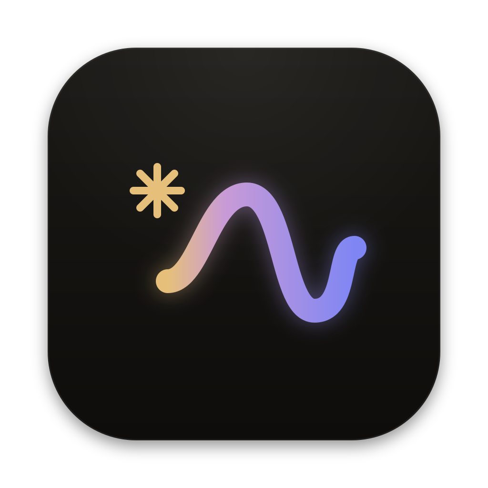

<p align="center"></p>
<h1 align="center">riff</h1>
<p align="center">A little room for what’s alive.</p>

Riff is Rob’s macOS writing room for catching a thought and following it somewhere. Three doors, one vault: a **quickie** is a scratch note for later, a **spark** is a line or three that goes live, a **riff** is a small complete thing written in one sitting. Everything lands in the Obsidian vault as ordinary Markdown with the vault’s own front matter, so the site’s sync sees exactly what it would have seen had the note been written in Obsidian.

The interface is one page of paper, mono chrome in lowercase, iA Writer Duo for the words and nothing else at full size.

## Three doors

**Riff** opens the fullscreen room with Hyper+R. A live Markdown editor with wiki links, headings, lists, images, undo, native spellcheck. The footer carries the riff’s connections and the verb: ⌘↵ ships it (`status: shipped`), or flip the `live` pill to `draft` to keep it a vault draft. Drafts autosave to `~/Documents/Riff` and wait behind ⌘K; ⌘N starts fresh; Escape sets the room aside; ⌘. fades the chrome.

**Spark** opens a small window with Hyper+S. What just struck you, a chip or two, ⌘↵. The note is written to `Sparks/` named by its first line, stamped with the minute, `status: shipped`, and the window is gone.

**Quickie** opens a small window with Hyper+Q. ⌘↵ appends it to the running `Quickies.md` note, which never reaches the site. Two hand-offs: *make it a spark* and *keep going in riff*.

## Connections

Every spark and riff can say what it belongs to, in the vault’s own vocabulary:

- **conversation** — the hub notes in the vault (`type: conversation`), hubs first, with how often each is used. ⌘1.
- **topic** — every topic in use across the vault, by frequency, or a new one. ⌘2.
- **sparked by / riffs on** — any note in the vault, written as a `[[wikilink]]`. ⌘3.

The pickers read the vault live, so spelling never drifts. For a riff the chips ride in a sidecar keyed by the draft (`~/.riff/connections.json`) and become `topics`, `riffs-on`, and `conversations` in the front matter on send; a spark’s become `topics`, `sparked-by`, and `conversations`.

## From another app

Trove, the reading app, can hand Riff a passage to respond to. It writes `~/.riff/handoffs/<id>.json` (`kind`, `quote`, `link`, `title`, `author`, `page`) and opens `riff://spark?handoff=<id>` or `riff://riff?handoff=<id>`. Riff reads the file, deletes it, and opens that door with the passage attached: under the words in the spark window, above the page in the room. The room starts a fresh draft for it; the one in progress is saved and waits behind ⌘K.

The passage is never part of the text being edited. On send it joins the note as a blockquote with its attribution, below a spark's words or above a riff's, and its `link` lands in `sparked-by` / `riffs-on`. The note is still named by the first line of what was written, never by the quote, and a quote with no words of your own can't be sent. The small × takes the passage off again, along with its link.

## Publishing the site

When a spark or a shipped riff leaves Riff, the site’s `Publish.command` runs in the background from the repo chosen in Settings → Files, and a notification says when it’s live (about a minute). Two sends in quick succession queue one extra run rather than racing. The menu bar also has *Publish the site* for a manual run. The switch is in Settings → Files.

## Settings

⌘, from any door. Files: the Riffs folder, the Sparks folder (defaults to `Sparks/` beside Riffs), the Quickies note, and the site repo. Keys: the three door hotkeys are global; everything else works while Riff is up. Drafts live in `~/Documents/Riff`; the spark and quickie windows keep their unfinished text in `~/.riff/`.

## Development

Requires Node and Rust with the macOS toolchain.

```sh
npm install
npm run dev
npm run tauri dev
```

The browser preview stores its own drafts locally in the browser. It does not access the Mac’s files or Obsidian vault. Native file dialogs, OS shortcuts, images from disk, and Obsidian opening run in the Mac app.

```sh
npm test
npm run build
cd src-tauri
cargo test
cargo clippy --all-targets -- -D warnings
```

`npm run tauri build` creates the macOS app bundle. A debug build can isolate settings, drafts, and quickie recovery by setting `RIFF_TEST_HOME` to an absolute temporary folder at build time. Release builds ignore this override.

## Provenance

Riff began as a fork of [Stik](https://github.com/0xMassi/stik_app) by Massi. The rebuilt app retains and extends the live Markdown editor. iA Writer Duo is bundled under the SIL Open Font License. See [LICENSE](LICENSE) and the font notice in `public/fonts`.
